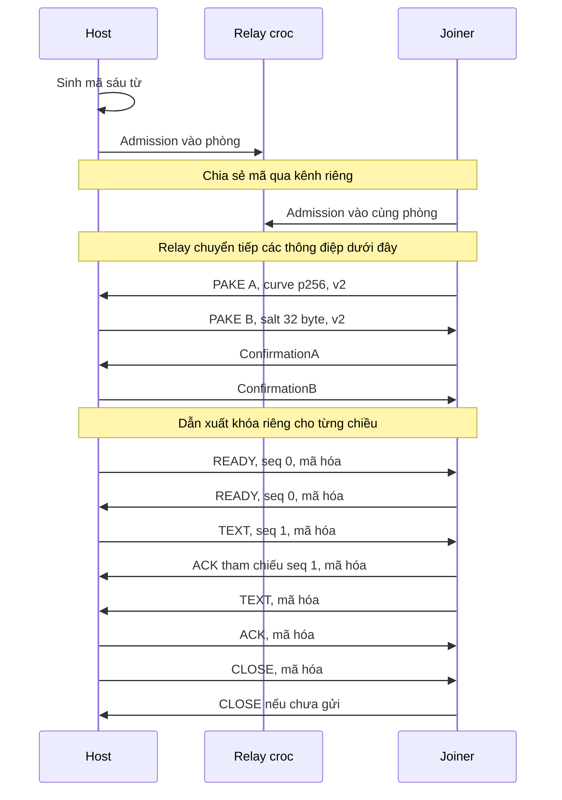

# Đặc tả secure chat cho croc

Trạng thái: dự thảo kỹ thuật v1, ngày 25 tháng 11 năm 2026. Các lệnh và giao
thức chat dưới đây là chức năng cần phát triển, chưa phải chức năng đã có trong
croc. Từ **PHẢI** diễn tả điều kiện bắt buộc để triển khai tương thích v1.

Tiến độ triển khai: đã có mã mời, PAKE chat, HKDF hai chiều, codec,
quản lý phiên READY/TEXT/ACK/PING/PONG/CLOSE và lệnh CLI/UI. Kiểm thử Linux
đã xác minh hai tiến trình CLI thật qua relay local, nhập mã được che,
Unicode, ACK và khôi phục terminal. Windows/macOS đã cross-compile; native
console smoke test trên Windows và kết quả CI đa nền tảng vẫn cần xác minh.
Đặc tả giữ trạng thái dự thảo trong khi hoàn tất nghiệm thu đa nền tảng.
Kết quả đã chạy và phần còn thiếu được ghi trong
[Secure chat validation](SECURE_CHAT_VALIDATION.md).

`croc chat` cung cấp cuộc trò chuyện văn bản 1:1 trong terminal, xác thực bằng
mã mời và mã hóa đầu cuối. Hai client sử dụng relay croc để gặp nhau và chuyển
tiếp dữ liệu; mỗi client tự thực hiện PAKE, dẫn xuất khóa và mã hóa tin nhắn.

## 1. Phạm vi và yêu cầu

### 1.1. Chức năng v1

- Tạo phiên và tham gia phiên bằng mã mời sáu từ.
- Hai người gửi và nhận văn bản UTF-8 đồng thời, bao gồm tiếng Việt.
- Sử dụng relay công khai hoặc relay tùy chỉnh của croc.
- Hiển thị trạng thái kết nối và xác nhận client bên kia đã nhận tin.
- Hỗ trợ `/help`, `/quit`, `/clear`, Ctrl+C và EOF từ terminal.
- Chỉ giữ lịch sử hiển thị trong RAM với giới hạn cụ thể.
- Kết thúc phiên khi mất kết nối; phiên tiếp theo có mã và khóa mới.
- Chạy trên Linux, macOS và Windows, kể cả bản build không có Tailcat.

Chat nhóm, lưu lịch sử, tự kết nối lại, gửi tệp trong phiên, browser và đường
truyền trực tiếp qua Tailcat nằm ngoài v1. Các chức năng đó cần đặc tả bổ sung.

### 1.2. Tiêu chí bảo mật

Client chỉ hiển thị trạng thái đã kết nối sau khi hoàn thành PAKE, kiểm tra
xác nhận khóa và nhận READY hợp lệ. Client PHẢI phát hiện bản ghi bị sửa,
phát lại, đổi chiều hoặc sử dụng sai phiên. Mã mời và khóa không được gửi dưới
dạng rõ đến relay; nội dung chat không được ghi vào log hay tệp lịch sử.

PAKE xác thực bên biết bí mật trong mã mời. Người dùng PHẢI chia sẻ mã qua kênh
phù hợp và giữ bí mật mã đó. Giao thức không xác thực tên thật hoặc tài khoản.
Relay vẫn biết phòng, địa chỉ kết nối, thời điểm và kích thước dữ liệu; relay
có thể từ chối phục vụ hoặc làm gián đoạn phiên. Máy đầu cuối bị kiểm soát,
ảnh chụp màn hình, terminal scrollback, swap và core dump không thuộc bảo đảm
không lưu lịch sử của ứng dụng.

V1 không có ratchet theo từng tin nhắn. Việc lộ khóa lưu lượng của một phiên
có thể làm lộ các bản ghi cùng chiều đã được ghi lại trong phiên đó.

## 2. Thành phần croc được tái sử dụng

| Thành phần hiện có | Vai trò trong chat | Thay đổi dự kiến |
| --- | --- | --- |
| [tcp](../tcp/tcp.go) | Vào phòng và chuyển tiếp hai chiều | Dùng API kết nối hiện có; kiểm thử với relay hiện tại |
| [comm](../comm/comm.go) | Framing, kết nối, proxy, giới hạn đọc | Bảo đảm deadline đọc và ghi độc lập |
| [codephrase](../codephrase/codephrase.go) | Sinh từ ngẫu nhiên, phân tích mã, chọn relay | Thêm GenerateChat và ParseChat |
| [pakekey](../pakekey/pakekey.go) | PAKE gắn mục đích/phòng, HKDF, xác nhận khóa | Cho phép PurposeChatV1 |
| [message](../message/message.go) | Envelope PAKE và PAKEConfirm | Dùng trong handshake; giới hạn giải nén riêng |
| [crypt](../crypt/crypt.go) | AES-GCM, nonce ngẫu nhiên, kiểm tra tag | Dùng NewAESGCM, EncryptAEAD, DecryptAEAD |
| [publicrelay](../publicrelay) | Cấu hình relay công khai | Chọn relay nhất quán theo mã |
| [CLI](../cli/cli.go) và [termui](../termui) | Lệnh, cấu hình, định dạng terminal | Lệnh và giao diện chat |

Các hàm PAKE của [SSH sharing](../sshshare/protocol.go) là mẫu về thứ tự bắt
tay. Chat sử dụng các package nền tảng trực tiếp, không khởi tạo shell hoặc
phụ thuộc build tag của SSH/Tailcat.

Không thay đổi kết quả dẫn xuất khóa cho transfer, local probe và SSH. Không
thay đổi phiên bản PAKE chung chỉ để thêm chức năng chat.

## 3. Giao diện dòng lệnh

```bash
croc chat                        # Tạo phiên mới
croc chat --join                 # Nhập mã tại lời nhắc được che
CROC_SECRET='...' croc chat       # Tham gia bằng mã trong biến môi trường
croc --relay localhost:9009 chat # Tạo phiên trên relay tùy chỉnh
```

Nếu có CROC_SECRET không rỗng, lệnh thực hiện join. `--join` và CROC_SECRET
cùng xuất hiện thì dùng CROC_SECRET; không hỏi lại. Mã không được nhận qua
đối số vị trí trong v1. Không có mã và không có `--join` thì tạo phiên.

CLI PHẢI từ chối đầu vào không phải terminal trước khi mở phiên, vì v1 chưa
định nghĩa chế độ pipe/script. Chat không lưu mã qua `--remember`, không tự
sao chép mã vào clipboard và không tự xuất URL chứa mã. Các tùy chọn dành
riêng cho truyền tệp hoặc chế độ classic phải bị từ chối nếu được chọn cho
chat, thay vì làm thay đổi giao thức chat.

Hỗ trợ `--relay` hoặc `--relay6` để chọn một relay, `--pass` và cấu hình proxy
hiện có của croc. Hai lựa chọn relay tường minh cùng xuất hiện là lỗi. Cấu
hình kết nối dùng lại cách ưu tiên của CLI hiện tại; `--pass` là mật khẩu
truy cập relay, độc lập với mã mời chat.

Người tạo thấy mã mời, relay đang dùng và trạng thái chờ. Nếu dùng relay tùy
chỉnh, hướng dẫn tham gia PHẢI chỉ rõ relay tương ứng. Lời nhắc và log lỗi
không lặp lại mã do người tham gia nhập.

`/clear` xóa lịch sử do ứng dụng đang giữ và làm mới vùng hiển thị. Nó không
được quảng bá là xóa an toàn dữ liệu khỏi terminal hoặc hệ điều hành. `//`
ở đầu dòng là cách gửi văn bản bắt đầu bằng `/`: bỏ đúng ký tự `/` đầu tiên.
Dòng trống không tạo tin nhắn. Nội dung khác được giữ nguyên khoảng trắng.

## 4. Mã mời và rendezvous

Host sinh sáu từ độc lập bằng nguồn ngẫu nhiên mật mã, dùng danh sách EFF
hiện có. ParseChat chấp nhận đúng sáu từ hợp lệ theo bộ phân tích của
codephrase, kể cả từ chứa dấu gạch nối như `yo-yo`. Chỉ bỏ khoảng trắng ở
hai đầu đầu vào; không tự thay chữ hoa hoặc biến đổi từ.

Với các từ w1 đến w6:

```text
canonicalCode = join([w1,w2,w3,w4,w5,w6], "-")
roomSelector  = join([w1,w2], "-")
room          = lowercase_hex(SHA256(UTF8(roomSelector + "croc-chat-v1")))
password      = UTF8(join([w3,w4,w5,w6], "-"))
```

Tên phòng trên chỉ là thông tin định tuyến; không coi nó là bí mật xác thực.
Không gửi canonicalCode hoặc password trong relay admission hay handshake.

Nếu không có relay tường minh, dùng `codephrase.RelayIndex(canonicalCode, N)`
trên danh sách relay công khai có cùng thứ tự ở hai client. Không tự chuyển
sang relay khác khi một phía gặp lỗi. Nếu hai client có danh sách khác nhau,
có thể cần dùng cùng relay tường minh. Mã v1 không mang danh sách relay.

Mỗi phía dùng ConnectToTCPServerControlContext để vào phòng. Sau admission,
relay chuyển tiếp byte giữa hai phía. Không yêu cầu thêm thông điệp phía
server. Mọi fallback admission nội bộ có sẵn trong thư viện không làm thay
đổi handshake giữa hai peer.

Host chỉ chấp nhận một lần thử bắt tay cho mỗi mã. PAKE thất bại hoặc peer
rời phiên thì đóng kết nối, không tự mở lại cùng phòng. Phòng hết hạn chờ
cũng làm lệnh kết thúc; lần tạo phiên tiếp theo sinh mã mới.

## 5. Trình tự kết nối



## 6. Handshake giữa hai peer

### 6.1. Tham số cố định

| Tham số | Giá trị v1 |
| --- | --- |
| Chat version | 1 |
| PAKE version | 2, theo pakekey.ProtocolVersion hiện tại |
| Purpose | `peer-chat-v1` |
| Curve | `p256` |
| Joiner | PAKE role 0, identity label `receiver` của pakekey |
| Host | PAKE role 1, identity label `sender` của pakekey |
| Salt | 32 byte ngẫu nhiên do host sinh |
| Marker | `chat-rendezvous-v1` |

V1 có một bộ thuật toán cố định, không thương lượng cipher hoặc tự hạ cấp.
Tên purpose chứa phiên bản chat để phiên bản được gắn vào PAKE và dẫn xuất
khóa. Marker chỉ hỗ trợ nhận diện giao thức, không phải bằng chứng xác thực.

### 6.2. Envelope và kiểm tra

Handshake dùng message.Encode với key nil, rồi comm.Send. Do đó envelope
PAKE sử dụng JSON và nén như croc hiện tại. Đọc bằng giới hạn frame 64 KiB
và giới hạn JSON sau giải nén 16 KiB. Decoder handshake của chat dùng
compress.Decompress với giới hạn này rồi kiểm tra JSON nghiêm ngặt trước
khi tạo message.Message. Không chỉ gọi message.DecodeWithLimit vì decoder
đó không giữ thông tin trường trùng lặp để kiểm tra sau khi unmarshal.

Các trường dưới đây dùng tên JSON của message.Message; b và b2 được Go mã
hóa thành Base64. V1 chỉ chấp nhận các trường liệt kê cho từng bước, không
chấp nhận trường trùng lặp, null hoặc kiểu dữ liệu khác kiểu yêu cầu. Lớp
handshake cần kiểm tra nghiêm ngặt ngoài việc gọi decoder hiện có.

| Bước | Bên gửi | Các trường bắt buộc |
| --- | --- | --- |
| 1 | Joiner | `t="pake"`, `v=2`, `b=A.Bytes()`, `b2=UTF8("p256")`, `f=["chat-rendezvous-v1"]` |
| 2 | Host | `t="pake"`, `v=2`, `b=B.Bytes()`, `b2=salt`, `f=["chat-rendezvous-v1"]` |
| 3 | Joiner | `t="pake-confirm"`, `v=2`, `b=ConfirmationA` |
| 4 | Host | `t="pake-confirm"`, `v=2`, `b=ConfirmationB` |

PAKE payload phải dài từ 1 đến 4096 byte; salt đúng 32 byte; confirmation
đúng 32 byte. Thư viện PAKE kiểm tra điểm đường cong. Sai thứ tự, phiên bản,
marker, curve, kích thước hoặc confirmation làm kết thúc phiên.

Chỉ trong giai đoạn trước bản ghi mã hóa đầu tiên, có thể bỏ qua frame
keepalive relay có body đúng một byte `0x01`, theo cách relay croc hiện có
hoạt động. Keepalive không được gia hạn deadline. Sau khi nhận READY hợp
lệ, mọi frame tiếp theo phải là bản ghi mã hóa; không có ngoại lệ plaintext.

### 6.3. Dẫn xuất và xác nhận khóa

Mỗi phía gọi pakekey.Init với password, role, p256, purpose và room; cập
nhật instance bằng giá trị PAKE của bên kia. Shared secret lấy bằng
SessionKey chỉ được sử dụng cục bộ.

Gọi pakekey.Derive với purpose `peer-chat-v1`, room, p256, đúng byte A và B
trên đường truyền và salt. Hàm hiện có dẫn xuất EncryptionKey và hai giá
trị HMAC xác nhận, ràng buộc với transcript của PAKE. Host kiểm tra
ConfirmationA trước khi gửi ConfirmationB. Joiner phải kiểm tra
ConfirmationB trước khi sử dụng kênh chat.

Sau bước này, ký hiệu Kroot là EncryptionKey. Mỗi chiều sử dụng một lần
HKDF-SHA256 độc lập, đầu ra đúng 32 byte:

```text
KhostToJoiner = HKDF-SHA256(
    IKM=Kroot, salt=salt,
    info=UTF8("croc/chat/v1/host-to-joiner"), L=32)

KjoinerToHost = HKDF-SHA256(
    IKM=Kroot, salt=salt,
    info=UTF8("croc/chat/v1/joiner-to-host"), L=32)
```

Không thêm byte NUL hoặc dấu xuống dòng vào info. Đây là HKDF đầy đủ gồm
Extract và Expand, tương ứng API hiện có trong golang.org/x/crypto/hkdf.
Host gửi bằng KhostToJoiner và nhận bằng KjoinerToHost; joiner làm ngược lại.
Kroot không trực tiếp mã hóa bản ghi. Sau khi tạo cipher theo chiều, giải
phóng state PAKE và xóa buffer khóa trung gian trong khả năng của ứng dụng.

## 7. Định dạng bản ghi chat

### 7.1. Framing và mã hóa

Sau handshake, hai phía chuyển sang bản ghi nhị phân không nén. Không dùng
message.Encode cho bản ghi chat vì API đó có nén và envelope riêng.

```text
Frame của comm:
    magic       4 byte ASCII "croc"
    bodyLength  uint32 little-endian
    body        nonce || ciphertext || GCM tag

Plaintext trước AES-GCM:
    version     uint8, luôn bằng 1
    type        uint8, theo bảng bên dưới
    seq         uint64 big-endian
    payload     các byte còn lại
```

Sử dụng AES-256-GCM của crypt.NewAESGCM, nonce ngẫu nhiên 12 byte được sinh
mới bởi crypt.EncryptAEAD cho mỗi lần mã hóa và tag 16 byte. Không có AAD
bổ sung; version, type và seq nằm trong plaintext được GCM xác thực. Khóa
đã được tách theo chiều và gắn với phiên qua PAKE.

Body tối thiểu 38 byte: nonce 12, header plaintext 10, tag 16. Giới hạn
body chung là 65536 byte, được kiểm tra trước khi cấp phát. Sau giải mã,
phải kiểm tra giới hạn và schema cụ thể theo loại. Ciphertext lỗi, header
sai hoặc dữ liệu thừa so với schema đều làm đóng phiên.

Nonce ngẫu nhiên có xác suất trùng rất nhỏ, không phải bảo đảm duy nhất
tuyệt đối. V1 giới hạn tối đa 2^20 bản ghi mỗi chiều mỗi phiên và thời gian
phiên tối đa 2 giờ. Không tự mã hóa/gửi lại cùng tin khi lỗi ghi; đóng phiên
với trạng thái nhận chưa xác định. Tái kết nối và tái sử dụng khóa bị cấm.

### 7.2. Loại bản ghi

| Type | Tên | Payload chính xác |
| --- | --- | --- |
| 1 | READY | Rỗng |
| 2 | TEXT | 1 đến 16384 byte UTF-8 hợp lệ |
| 3 | ACK | uint64 big-endian: seq của TEXT ở chiều ngược lại |
| 4 | PING | 8 byte token ngẫu nhiên |
| 5 | PONG | 8 byte token sao chép từ PING |
| 6 | CLOSE | uint8 reason |

CLOSE reason: 0 = thoát bình thường; 1 = hết thời lượng; 2 = hết ngân sách
bản ghi; 3 = quá tải hàng đợi. Reason khác và type khác bị từ chối trong v1.
Thông báo lỗi chi tiết chỉ hiển thị cục bộ, không đưa dữ liệu không tin cậy
vào thông báo điều khiển của terminal.

TEXT giữ nguyên byte UTF-8, không chuẩn hóa Unicode. ACK tham chiếu seq của
TEXT, không phải seq riêng của ACK. Không ACK cho READY, ACK, PING, PONG
hoặc CLOSE. PONG không tạo phản hồi tiếp theo.

### 7.3. Số thứ tự và ngân sách khóa

Mỗi chiều bắt đầu seq=0. Bản ghi đầu tiên PHẢI là READY. Mọi loại bản ghi
đều tiêu thụ một seq; writer duy nhất cấp seq ngay trước khi mã hóa. Reader
chỉ cập nhật expectedSeq sau khi GCM, schema và trạng thái đều hợp lệ.

Reader yêu cầu seq đúng bằng expectedSeq. Seq thấp hơn là phát lại, cao hơn
là thiếu hoặc đảo bản ghi; cả hai kết thúc phiên. Không thử đồng bộ lại.

Seq hợp lệ nằm trong [0, 2^20-1]. Seq cuối cùng chỉ được dùng cho CLOSE
reason=2. Nếu một bên nhận CLOSE hợp lệ thì xử lý đóng phiên thay vì yêu
cầu đủ các số thứ tự tiếp theo. Mất kết nối trước CLOSE được coi là kết
thúc không xác nhận; TCP EOF tự nó không chứng minh peer chủ động thoát.

### 7.4. Xác nhận nhận tin

Writer ghi frame TEXT thành công thì UI hiển thị "đang chờ xác nhận".
Receiver tạo ACK sau khi giải mã, kiểm tra và đưa tin vào hàng đợi hiển
thị có giới hạn thành công. ACK có nghĩa "client bên kia đã nhận", không
chứng minh người dùng đã đọc hoặc nội dung đã được lưu bền vững.

Sender chỉ chấp nhận ACK cho TEXT thực sự đã gửi và còn trong tập pending.
ACK sai tham chiếu hoặc xác nhận lần hai là lỗi giao thức. Nếu quá 30 giây
chưa có ACK, UI hiển thị "chưa xác định" nhưng vẫn giữ tham chiếu pending
để nhận ACK đến muộn. Không tự gửi lại. Khi pending đầy, ngừng nhận lệnh
gửi mới và báo lý do cho người dùng.

Writer PHẢI đăng ký tham chiếu pending ngay trước lần ghi frame TEXT, dưới
cơ chế đồng bộ với reader, để ACK đến nhanh không bị xem là sai tham chiếu.
ACK hợp lệ có thể được xử lý trước khi goroutine ghi trả về; không ghi đè
trạng thái đã nhận bằng trạng thái chờ. Nếu ghi thất bại, các tin chưa có
ACK có trạng thái chưa xác định; tin đã có ACK giữ trạng thái đã nhận.

## 8. Trạng thái và vòng đời

```text
START -> CONNECTING -> WAIT_PEER/AUTHENTICATING
      -> CONFIRMED -> READY_SENT -> ACTIVE -> CLOSING -> CLOSED

Lỗi ở bất kỳ bước nào -> đóng tài nguyên -> FAILED
Hủy cục bộ trước ACTIVE -> đóng tài nguyên -> CLOSED
```

WAIT_PEER dành cho host chờ thông điệp PAKE đầu tiên. Sau khi xác nhận khóa,
mỗi phía gửi READY trước khi gửi bất kỳ bản ghi ứng dụng khác. Reader kiểm
tra READY đầu tiên của peer; ACTIVE yêu cầu cả gửi READY thành công và nhận
READY hợp lệ. TEXT có thể theo sát READY trên TCP và phải được xử lý đúng
thứ tự, kể cả khi hai frame đến trong cùng một lần đọc.

Trong ACTIVE có một vòng đọc và một vòng ghi. PING/PONG, ACK, input và yêu
cầu thoát cùng đi qua writer; không có goroutine nào tự mã hóa/ghi ngoài
writer. Dành hàng đợi điều khiển riêng có giới hạn để ACK/PONG không bị
kẹt sau hàng loạt TEXT. CLOSE có ưu tiên cao nhất.

Khi nhận CLOSE, ngừng nhận input và bỏ các TEXT chưa gửi. Nếu chưa gửi
CLOSE thì gửi một CLOSE reason=0 đáp lại. Sau khi đã gửi và nhận CLOSE,
đóng socket. Khi chủ động thoát, đợi CLOSE phản hồi tối đa 2 giây rồi đóng.
Không coi các TEXT pending là đã nhận chỉ vì phiên đóng bình thường.

Giới hạn đóng 2 giây tính từ khi yêu cầu đóng, bao gồm cả thời gian writer
đang bị chặn. Bộ điều khiển phiên phải đóng socket khi hết hạn để ngắt
lệnh ghi; không chờ write timeout 10 giây rồi mới bắt đầu đếm thời gian đóng.

Lỗi xác thực hoặc định dạng làm đóng socket ngay, không cố gửi thông báo
lỗi trên một luồng đã mất đồng bộ. Sai mã không được tự thử lại. Host có
thể bị kẻ tấn công làm kết thúc phiên bằng một lần thử sai; đây là đánh
đổi v1 nhằm không cho phép đoán mã liên tiếp trong cùng phiên.

## 9. Timeout và giới hạn tài nguyên

| Hạng mục | Giá trị v1 |
| --- | --- |
| Kết nối và relay admission | Deadline chung 30 giây |
| Host chờ peer | 5 phút kể từ khi admission xong |
| PAKE | 30 giây; host tính từ frame PAKE đầu, joiner từ lúc bắt đầu gửi PAKE |
| Chờ READY | 10 giây từ khi hoàn tất xác nhận khóa ở mỗi phía |
| Ghi một frame khi ACTIVE | 10 giây |
| Heartbeat | Gửi PING mỗi 30 giây nếu không có PING đang chờ |
| PONG | Phải khớp token PING đang chờ trong 90 giây kể từ khi ghi PING thành công |
| Thời lượng phiên | 2 giờ từ khi ACTIVE ở mỗi phía |
| Đóng phiên | Tối đa 2 giây sau khi yêu cầu đóng |
| TEXT chờ gửi | 64 tin, tổng nội dung tối đa 1 MiB |
| TEXT chờ ACK | 64 tin, chỉ giữ metadata cần thiết |
| Tin nhận chờ hiển thị | 64 tin, tổng nội dung tối đa 1 MiB |
| Điều khiển chờ gửi | 128 bản ghi; CLOSE có slot dành riêng |
| Lịch sử UI | Tối đa 500 tin và 2 MiB UTF-8, bỏ tin cũ nhất để thỏa cả hai |
| Bản nháp | Tối đa 64 KiB; TEXT vượt 16 KiB bị từ chối, giữ bản nháp để sửa |

Không gửi PING/PONG trong handshake. Keepalive relay không gia hạn bất kỳ
deadline xác thực nào. Deadline đọc và ghi phải độc lập; reader không được
xóa write deadline của writer. Context cancellation phải đóng socket để
giải phóng các goroutine đang chờ I/O.

Relay croc mặc định xóa phòng sau 3 giờ tính từ khi tạo, kể cả phòng đã ghép
hai peer; heartbeat của chat không gia hạn TTL đó. Giới hạn phiên cục bộ 2
giờ giúp kết thúc có chủ đích trước TTL mặc định, nhưng relay công khai có
thể cấu hình ngắn hơn hoặc ngắt kết nối bất kỳ lúc nào. Vì vậy 2 giờ là
giới hạn trên của client, không phải cam kết relay giữ phiên đủ 2 giờ.

PONG không khớp hoặc không có PING đang chờ là lỗi giao thức. Peer gửi PING
thì trả đúng một PONG; không xem PING đó là phản hồi cho PING của mình.
Nếu hàng đợi nhận hoặc điều khiển đầy, đóng với reason=3 khi còn ghi được,
sau tối đa 2 giây phải kết thúc. Không tạo goroutine không giới hạn cho
mỗi tin nhắn. UI đầy hàng đợi gửi thì từ chối gửi thêm, giữ bản nháp để
người dùng quyết định; không tự bỏ tin mà không thông báo.

## 10. Giao diện và dữ liệu nhạy cảm

UI có một chủ thể quản lý terminal/input. Tin đến không được phá dòng đang
gõ. Nội dung peer phải được render như văn bản: vô hiệu hóa ESC, OSC, CSI,
các ký tự điều khiển và điều khiển đổi hướng văn bản có thể giả mạo nhãn.
LF và TAB có thể được render bằng xuống dòng/thụt lề có kiểm soát. Kiểm
tra protocol áp dụng trên byte gốc; làm sạch chỉ áp dụng khi hiển thị.

Nhãn "Bạn", "Người bên kia", trạng thái và lỗi là do ứng dụng tạo. Nội dung
nhận không được dùng làm format string, tiêu đề terminal, lệnh shell hoặc
dữ liệu clipboard. Các dòng tiếp nối phải được thụt lề để phân biệt với
thông báo của ứng dụng.

Không ghi plaintext, mã mời, room, PAKE password, khóa, transcript hoặc
nội dung bản ghi vào log, kể cả debug. Log chỉ chứa giai đoạn, mã lỗi và
thống kê không có nội dung. Không đưa secret vào panic/error formatting.
Mã mời chỉ xuất tại UI host theo yêu cầu chức năng; không đưa vào analytics.

Đóng phiên phải giải phóng lịch sử, pending và buffer; ghi đè buffer khóa
khi có thể. Không cam kết xóa mọi bản sao khóa trong Go runtime hay hệ
điều hành. Khôi phục chế độ terminal trên đường thoát bình thường, lỗi và
Ctrl+C.

## 11. Tổ chức mã nguồn và tương thích

```text
src/chat/
    session.go       # Host/Join, context, lifecycle, vòng đọc/ghi
    handshake.go     # PAKE, giới hạn, kiểm tra envelope
    keys.go          # HKDF cho từng chiều
    record.go        # Header, AES-GCM, seq, ngân sách bản ghi
    protocol.go      # Kiểu payload, ACK, heartbeat, CLOSE

src/cli/
    chat.go          # Lệnh, cấu hình relay/proxy, nhập mã
    chat_ui.go       # Input, render an toàn, trạng thái tin

src/docs/
    SECURE_CHAT_SPEC.md
```

Package chat không in trực tiếp ra stdout. API nhận context và cấu hình,
cho phép SendText/Close, phát sự kiện Connected, MessageReceived,
Acknowledged, Closed và Failed. Mọi channel/queue có giới hạn và quyền sở
hữu đóng rõ ràng. Kiểm thử protocol phải chạy được không cần terminal.

Đăng ký lệnh trong src/cli/cli.go. Các thay đổi dùng chung giới hạn ở mục
đích PAKE mới, mã mời mới và hỗ trợ deadline phù hợp. Không đưa chức năng
chat vào state machine truyền tệp của src/croc/croc.go.

Hai client cần hỗ trợ chat v1. Client croc cũ không được bảo đảm báo lỗi
thân thiện khi người dùng chạy lệnh mới; hướng dẫn sử dụng phải yêu cầu
hai bên cập nhật. Chat không fallback sang transfer/SSH khi gặp giao thức
lạ. Relay cũ được dùng nếu hỗ trợ admission và chuyển tiếp byte hiện có;
kiểm thử thực tế quyết định khả năng tương thích.

## 12. Kiểm thử và tiêu chí nghiệm thu

| Nhóm | Trường hợp bắt buộc | Kết quả mong đợi |
| --- | --- | --- |
| Mã mời | Sáu từ, từ có gạch nối, sai số từ, mã transfer/SSH | Parse chính xác; namespace tách biệt |
| PAKE | Hai phía cùng mã; cùng room nhưng khác phần password | Cùng mã thành công; sai bí mật thất bại |
| Ràng buộc | Đổi room, purpose, role, salt hoặc byte PAKE | Không hoàn thành xác nhận khóa |
| Handshake | Sai phiên bản/curve/marker, trường trùng, frame quá lớn, sai thứ tự | Từ chối có giới hạn thời gian/bộ nhớ |
| Khóa | Test vector cho HKDF hai chiều với đầu vào cố định | Hai phía ánh xạ đúng send/receive; hai khóa khác nhau |
| Bản ghi | Test vector codec với nonce cố định trong test | Endianness, header và giải mã khớp đặc tả |
| Toàn vẹn | Sửa nonce/ciphertext/tag; dùng khóa phiên khác hoặc chiều khác | Không giao nội dung cho UI |
| Thứ tự | Phát lại, bỏ một frame, đảo frame, vượt ngân sách | Đóng phiên hoặc CLOSE đúng giới hạn |
| ACK | ACK đúng, trùng, sai tham chiếu, đến muộn | Trạng thái đúng; không tuyên bố đã đọc |
| Song công | Hai phía gửi đồng thời, READY đi sát TEXT | Không deadlock, không đảo seq |
| Input | Tiếng Việt, emoji, khoảng trắng, UTF-8 lỗi, quá 16 KiB | Giữ nội dung hợp lệ; từ chối dữ liệu lỗi |
| Terminal | ESC/OSC/CSI, bidi controls, giả nhãn trạng thái | Hiển thị an toàn, không thực thi điều khiển |
| I/O | Frame bị chia nhỏ/gộp; peer gửi chậm hoặc ngừng đọc | Không lỗi framing, deadline độc lập |
| Vòng đời | Ctrl+C, EOF, CLOSE đồng thời, mất mạng, EOF thiếu CLOSE | Dọn tài nguyên; phân biệt thoát và mất kết nối |
| Heartbeat | Thiếu PONG, token sai, keepalive trong handshake | Timeout đúng; không kéo dài xác thực |
| Relay | Hai client qua relay hiện tại, người thứ ba, relay tùy chỉnh, proxy | Chat hoạt động; giới hạn phòng được giữ |
| Tài nguyên | Flood TEXT/PING, pending đầy, UI chậm | Bộ nhớ/queue hữu hạn, không tăng goroutine vô hạn |
| Riêng tư | Bật debug, lỗi handshake, thoát và panic có kiểm soát | Không lộ secret/nội dung vào log |
| Hồi quy | Transfer, SSH và các package dùng chung | Kiểm thử liên quan vẫn thành công |

Kiểm thử codec/handshake cần fuzz input, test race cho vòng đời song công
và cancellation. Test vector sử dụng khóa/nonce giả cố định phải chỉ tồn
tại trong kiểm thử; đường chạy thực luôn dùng nguồn ngẫu nhiên mật mã.

Nghiệm thu tích hợp gồm hai tiến trình CLI thật và một relay: tạo mã,
join, gửi nhiều tin hai chiều, thấy ACK, thử mất mạng và đóng phiên. Chạy
smoke test terminal trên Linux, macOS, Windows; build croc_no_tailcat vẫn
có chat. Bắt gói để minh họa không có plaintext chỉ là một phần demo, không
thay thế kiểm thử giao thức và đánh giá thiết kế.

## 13. Thứ tự triển khai

Các bước dưới đây là các đơn vị thay đổi để review riêng. Hoàn thành kiểm
thử của mỗi bước trước khi tích hợp bước tiếp theo. Tên file mới là tên dự
kiến; mọi thay đổi giao thức vẫn phải tuân thủ các mục 4 đến 9.

### 13.1. Chuẩn bị và kiểm tra nền

Ghi nhận trạng thái Git và đọc cấu hình CI hiện tại. Chạy kiểm thử baseline
cho codephrase, pakekey, comm, message và tcp để phân biệt lỗi có trước với
lỗi do thay đổi. Xác nhận công cụ Go đáp ứng go.mod. Chưa cần gọi public
relay để kiểm thử các package nền tảng.

### 13.2. Mã mời và mục đích PAKE

Sửa src/codephrase/codephrase.go để thêm ChatComponents, ChatCodeWordCount,
GenerateChat và ParseChat. Dùng lại generateWords và effWordSequence; tên
phòng được tính theo mục 4. Viết kiểm thử trong codephrase_test.go cho mã
sáu từ, khoảng trắng đầu/cuối, từ có gạch nối, mã lỗi và phân tách phòng
giữa chat/SSH/transfer với cùng đầu vào.

Sửa src/pakekey/pakekey.go để thêm PurposeChatV1 và mở rộng allowlist trong
Identities. Không đổi thứ tự transcript hay output cho các purpose cũ.
Trong pakekey_test.go, thêm test hai vai trò chat có khóa khớp, purpose khác
không xác nhận được và vector hồi quy cho các purpose hiện có.

Nghiệm thu: hai phía phân tích cùng mã ra cùng room/password; khóa chat chỉ
được xác nhận với ngữ cảnh đúng; kiểm thử package hiện tại vẫn thành công.

### 13.3. Deadline phục vụ giao tiếp hai chiều

Rà soát các call site SetDeadline/SetWriteDeadline trước khi sửa
src/comm/comm.go. Đường đọc chỉ đặt read deadline, không xóa write deadline.
Call site từng dựa vào việc reader xóa deadline chung phải tự quản lý
deadline theo từng giai đoạn. Giới hạn kích thước và timeout đọc body hiện
có vẫn được kiểm tra.

Thêm test trong comm_test.go: khởi động đọc khi một lệnh ghi đang chờ không
được làm mất write timeout; deadline đọc không làm hỏng ghi độc lập; context
cancellation/đóng socket giải phóng I/O. Rà soát admission trong src/tcp để
deadline bắt tay không còn sót lại khi bắt đầu truyền tin. Chỉ sửa call site
liên quan nếu việc rà soát cho thấy cần thiết.

Nghiệm thu: timeout hoạt động đúng trong net.Pipe và TCP loopback; test comm,
tcp, transfer và SSH liên quan vẫn thành công.

### 13.4. Codec và khóa chat

Tạo src/chat/protocol.go, limits.go, keys.go và record.go. Khai báo type,
reason, giới hạn và header nhị phân theo đặc tả; triển khai HKDF hai chiều
và codec AES-GCM bằng src/crypt. Tách encode/decode payload khỏi I/O để kiểm
thử độc lập. Kiểm tra UTF-8, kích thước, version và seq trước khi chuyển
nội dung cho tầng session.

Thêm keys_test.go, record_test.go và protocol_test.go với test vector đầu
vào/đầu ra cố định, sửa tag/ciphertext, đổi chiều khóa, phát lại, sai thứ tự,
biên kích thước và hết ngân sách khóa. Fuzz decoder với dữ liệu tùy ý và
các bản ghi hợp lệ đã bị biến đổi. Nonce cố định chỉ dùng trong test vector.

Nghiệm thu: codec đúng byte theo đặc tả và từ chối mọi dữ liệu sai trong
ma trận kiểm thử, chưa cần kết nối mạng hay terminal.

### 13.5. Handshake và relay

Tạo src/chat/handshake.go, handshake_codec.go và relay.go. Dùng publicrelay
và RelayIndex để hai client chọn cùng địa chỉ, hoặc dùng relay tường minh.
Admission dùng tcp.ConnectToTCPServerControlContext với deadline chung và
hủy kết nối khi context hết hạn.

Handshake codec dùng message.Encode cho phía gửi, giải nén có giới hạn và
decoder JSON nghiêm ngặt cho phía nhận. Dùng pakekey.Init/Derive/Confirm
cho bốn bước bắt tay. Sau khi xác nhận khóa, tạo cipher hai chiều và gửi
READY theo codec mới. Các lỗi trả ra phải được redact để không chứa bí mật.

Viết handshake_test.go và relay_test.go: handshake hai đầu qua net.Pipe,
relay thật ở loopback, sai password cùng room, đổi purpose, salt, version,
marker, trường trùng và peer im lặng. Relay của bài test sử dụng listener
cổng ngẫu nhiên và shutdown có kiểm soát; không phụ thuộc public relay.

Nghiệm thu: hai client hoàn thành PAKE và READY qua relay croc hiện tại;
sai xác thực kết thúc trong deadline và không bắt đầu chat.

### 13.6. Session và API cho giao diện

Tạo src/chat/session.go, api.go và errors.go. API dự kiến gồm StartHost,
Join, SendText, Close, Events và Wait; cấu hình chứa địa chỉ/mật khẩu relay
và context điều khiển vòng đời. StartHost trả về sau admission để UI lấy
mã mời và hiển thị ngay khi đang chờ peer. Handshake tiếp tục trong session;
Join cũng phát tiến trình qua Events. Chỉ Connected mới có nghĩa là READY
hai phía đã hoàn tất. SendText trước Connected trả lỗi trạng thái.

SendText sao chép dữ liệu vào hàng đợi có giới hạn và trả ID cục bộ để UI
theo dõi tin. Khi writer cấp seq, session lưu ánh xạ ID cục bộ với seq; sự
kiện Sent/Acknowledged tham chiếu ID đó. Queue đầy trả lỗi đồng bộ để UI
giữ bản nháp. API SendText thành công chỉ có nghĩa đã nhận vào hàng đợi.

Một writer sở hữu seq và cipher gửi; một reader sở hữu expectedSeq và
cipher nhận. Bảo vệ pending/đóng phiên bằng cơ chế đồng bộ rõ ràng. Triển
khai ACK, heartbeat, timeout, ngân sách khóa và CLOSE. Events có giới hạn;
UI chậm được xử lý theo chính sách quá tải của mục 9, không chặn reader
vô hạn. Close phải gọi được nhiều lần và Wait phải hoàn tất sau khi dọn
tài nguyên. Định nghĩa rõ ID/lý do đóng để UI không cần phân tích chuỗi lỗi.

Thêm session_test.go và integration_test.go: gửi đồng thời, ACK đến trước
khi writer trả về, queue đầy, heartbeat thiếu/sai, CLOSE đồng thời, mất mạng,
writer nghẽn và cancel trong từng trạng thái. Dùng timeout nhỏ được tiêm
nội bộ trong test; giá trị wire/default của v1 vẫn theo đặc tả.

Nghiệm thu: hai client trao đổi văn bản và ACK qua relay, dọn tài nguyên
đúng hạn; kiểm thử race không phát hiện truy cập state không đồng bộ.

### 13.7. CLI và terminal

Sửa src/cli/cli.go để đăng ký chat và --join. Thêm src/cli/chat.go để kiểm
tra TTY, chọn host/join, nhập mã được che, áp dụng relay/password/proxy và
từ chối cờ không phù hợp. Không dùng hàm nhập hiện có nếu nó echo mã hoặc
không hủy được; xây helper có kiểm thử theo yêu cầu che input/cancellation.

Thêm chat_ui.go cho một vòng điều khiển input/render, lịch sử hữu hạn,
bản nháp, nhãn trạng thái và lệnh slash. Ưu tiên thư viện terminal đã có
trong go.mod; nếu cần thư viện mới phải đánh giá riêng khả năng hủy input,
render đồng thời và Windows trước khi chọn. Tách sanitizer thành hàm thuần
để kiểm thử ESC/OSC/CSI, bidi controls và giả nhãn. Input reader phải được
dừng khi phiên đóng; khôi phục terminal ở mọi đường thoát.

Viết chat_test.go và chat_ui_test.go cho định tuyến lệnh, CROC_SECRET,
relay tùy chỉnh, non-TTY, redaction, giữ bản nháp khi queue đầy, Unicode và
ký tự điều khiển. Chạy test PTY cho nhập mã, tin đến khi đang gõ và Ctrl+C.
Windows cần smoke test thực tế cho console input và khôi phục terminal;
cross-compile không thay thế được phép kiểm tra này.

Nghiệm thu: hai terminal dùng được croc chat theo mục 3, có trạng thái gửi
và nhận đúng, không rò mã vào log hoặc làm hỏng input khi nhận tin.

### 13.8. Tài liệu và kiểm tra tích hợp cuối

Cập nhật README.md với cách tạo/join, yêu cầu hai client hỗ trợ chat và
giới hạn phiên. Bổ sung hướng dẫn test vào src/docs/TESTING.md. Rà soát
manual, help và shell completion hiện có; cập nhật thông qua bộ sinh của
repo khi chúng được sinh tự động. Chỉ chuyển trạng thái đầu đặc tả từ dự
thảo sang đã triển khai khi các mục nghiệm thu thực sự hoàn thành.

Các lệnh kiểm thử trọng tâm sau khi các file tương ứng đã tồn tại:

```bash
go test ./src/codephrase ./src/pakekey ./src/comm ./src/message ./src/tcp
go test ./src/chat ./src/cli
go test -race ./src/chat ./src/comm
go test ./src/croc ./src/sshshare
go test -tags croc_no_tailcat ./src/chat ./src/cli
go build -o /tmp/croc-chat .
go build -tags croc_no_tailcat -o /tmp/croc-chat-relay .
```

Chạy các gate CI áp dụng của repo, fuzz decoder trong thời gian hữu hạn và
smoke test Linux/macOS/Windows. Demo tích hợp dùng một relay local và hai
tiến trình CLI, rồi thử một phiên nhỏ qua public relay trên hai mạng khác
nhau. Kiểm thử tải/lỗi lặp lại chạy trên relay local. Ghi riêng kết quả
kiểm thử đã chạy và phần còn cần môi trường khác để xác minh.

Trước khi tuyên bố đáp ứng đặc tả, rà soát ánh xạ vai trò PAKE, label HKDF,
ngân sách nonce/khóa, chuyển trạng thái READY và tất cả đường đóng kết nối.
Mọi thay đổi không tương thích với byte trên đường truyền phải có phiên
bản và purpose mới; không âm thầm đổi chat v1.

## 14. Tài liệu tham chiếu

- [SSH sharing của croc](SSH_SHARING.md): mô hình mã mời và PAKE hiện có.
- [RFC 5869](https://www.rfc-editor.org/rfc/rfc5869): HKDF và trường info.
- [RFC 5116](https://www.rfc-editor.org/rfc/rfc5116): AEAD, nonce và AES-GCM.
- Nullwire: tham khảo trải nghiệm host/join và chat terminal tạm thời. Giao
  thức v1 ở đây dùng PAKE của croc và không tương thích wire với nullwire.
